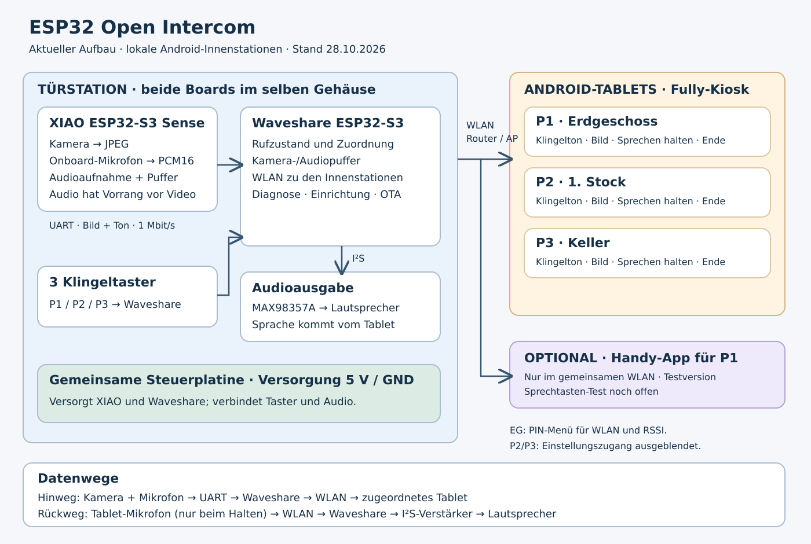

# ESP32 Open Intercom

Lokale Video-Türsprechanlage für drei Parteien: Eine Türstation mit zwei ESP32-S3-Boards versorgt Android-Tablets mit Klingelmeldung, Livebild und Audio. Gegensprechen erfolgt über eine gedrückt gehaltene Sprechtaste. Für den Betrieb wird keine Cloud benötigt.

## Aufbau

**Beide ESP32-Boards sitzen zusammen mit der Steuerplatine im Gehäuse der Türstation.**

- **Seeed XIAO ESP32-S3 Sense:** erfasst Kamerabilder und Mikrofonton. Bild und Ton gehen über UART mit 2 Mbit/s zum Waveshare. Mikrofonaufnahme und Versand sind getrennt; Audio wird beim Senden bevorzugt.
- **Waveshare ESP32-S3 DevKit:** liest die drei Klingeltaster, verwaltet Ruf und Gespräch, überträgt die Daten im WLAN und empfängt die Sprache vom Tablet.
- **MAX98357A und Lautsprecher:** geben den vom Tablet gesendeten Ton an der Türstation aus. Der Rückweg läuft direkt vom Waveshare über I²S zum Verstärker.
- **Gemeinsame Steuerplatine:** verbindet die Komponenten und versorgt beide Boards über ihren 5-V/GND-Eingang.
- **Android-App auf drei Fire-Tablets:** P1 = Erdgeschoss, P2 = 1. Stock, P3 = Keller. Jedes Tablet reagiert auf seine zugewiesene Klingeltaste und verwendet seinen eigenen Klingelton. Fully Single App Kiosk übernimmt den Kioskbetrieb.

Ein Router beziehungsweise Access Point verbindet Türstation und Innenstationen. Die aktuellen Innenstationen verwenden die native Android-App; die älteren Browser-Oberflächen im Repository sind historische Entwicklungsstände.

## Funktionen

| Funktion | Stand |
|---|---|
| Drei Klingeltaster mit Zuordnung P1/P2/P3 | Implementiert |
| Livebild und Audio von der Türstation | Implementiert und bereits praktisch betrieben |
| Gegensprechen per Sprechtaste, Ende-Taste | In der Tablet-App implementiert und praktisch geprüft |
| Unbeantworteter Ruf endet nach 30 Sekunden | Implementiert |
| Gesprächsfreigabe nach Verbindungsabbruch | Implementiert |
| Eigene Klingeltöne und Etagenanzeige | Implementiert; P3 heißt Keller |
| Tablet-Autostart, Home-Sperre und Mikrofonfreigabe | Mit Fully eingerichtet und nach Neustart geprüft |
| WLAN-Empfangsanzeige über Zahnrad | Implementiert auf allen drei Tablets, ohne PIN |
| Gemeinsamer WLAN-Wechsel von Tablet und Türstation | Implementiert, mit Rückfall bei fehlender Bestätigung |
| RSSI-Anzeige und WLAN-Diagnoseseite | Implementiert |
| Firmware-Update des Waveshare über WLAN | Implementiert und am Gerät geprüft |
| Separate Handy-App für P1 im selben WLAN | Testversion; Sprechtastenprüfung noch offen |

**Aktuell offene Punkte:** Im zuletzt dokumentierten Standorttest vom 25.10.2026 bestand erneut eine Störung beim Kamera-/Audioempfang über UART. Die Diagnose zeigt diese an, behebt sie aber nicht. Ein erfolgreicher vollständiger Audio-/Videotest nach diesem Standortwechsel ist noch nicht dokumentiert. Die Handy-Testversion ist ebenfalls noch nicht abschließend freigegeben.

MQTT, Home Assistant und Türöffnersteuerung gehören nicht zum derzeit bestätigten Funktionsumfang.

## Gebrauchsanleitung

[Druckbare Anleitung als PDF](docs/Gebrauchsanleitung.pdf) · [Admin-Fassung mit Lautstärke](docs/Gebrauchsanleitung-Admin.pdf) | [Bearbeitbare Textfassung](docs/Gebrauchsanleitung.md) | Handy-Apps installieren: [PDF](docs/Handy-App-Installation.pdf) · [Text](docs/Handy-App-Installation.md)

## Bedienung

1. Klingeltaster P1, P2 oder P3 an der Türstation drücken.
2. Das zugewiesene Tablet klingelt und zeigt das Kamerabild.
3. **Sprechen gedrückt halten:** nimmt den Ruf an und aktiviert das Tablet-Mikrofon. Währenddessen ist die Wiedergabe der Türstation am Tablet stumm.
4. **Loslassen:** beendet die Mikrofonübertragung; der Ton der Türstation wird wieder hörbar.
5. **Ende:** beendet den Ruf. Ohne Annahme läuft er nach 30 Sekunden ab.

Bei der Einrichtung die Mikrofonabfrage **direkt am Tablet mit „Bei Nutzung der App“ bestätigen**. Eine ausschließlich über USB gesetzte Freigabe ersetzt diesen Schritt im bewährten Ablauf nicht.

## WLAN und Wartung

An jedem Tablet: **Zahnrad rechts oben antippen** öffnet direkt die **WLAN-Empfangsanzeige** der Türstation mit Signal, IP und Diagnoseseite. Seit 06.11.2026 ohne PIN und ohne Menüpunkt zum Ändern des WLANs.

Neue WLAN-Zugangsdaten bekommt die Station über ihr Einrichtungs-WLAN: Ist sie 60 Sekunden ohne WLAN, öffnet sie „OpenIntercom-Setup“ selbst. Mit einem Handy verbinden und http://192.168.4.1 öffnen. Hängt sie in einem WLAN, das die Tablets nicht erreichen, hilft nur ein Neustart mit Netzwahl (P1 = Test-WLAN, P2 = Haus-WLAN) oder USB; eine Haltegeste an P1 gibt es seit 06.11.2026 nicht mehr. Zugangsdaten werden auf der Station gespeichert; die aktuelle Firmware enthält kein fest eingebautes privates WLAN als Rückfall.

- Diagnose im lokalen Netz: http://STATIONS-IP/diagnose
- JSON-Diagnose: http://STATIONS-IP/api/diagnose
- Waveshare-Update: http://STATIONS-IP/update, mit Administrator-Anmeldung und Sitzungstoken
- OTA aktualisiert die Waveshare-Firmware; die XIAO wird separat per USB programmiert.

Details zu Freigaben, WLAN-Wechsel, Wiederherstellung und OTA: [WLAN-Einrichtung und Wartung](docs/wlan-einrichtung.md).

## Quellcode

| Verzeichnis | Zweck |
|---|---|
| firmware/doorstation_v2 | Aktuelle Waveshare-Firmware |
| firmware/xiao_cam/xiao_video_uart | XIAO: Kamera, Mikrofon und UART |
| android | Tablet-App |
| android-phone | Handy-Apps, je eine pro Klingel (P1–P3) |
| hardware/aussenstation | KiCad-Unterlagen der Steuerplatine |
| tools | Wartungswerkzeuge, unter anderem gedrosselter OTA-Upload |

Weitere technische Details: [Architektur](docs/ARCHITECTURE.md), [Stand 17.10.2026](docs/stand-2026-10-17.md), [Tablet-Bildausrichtung 24.10.2026](docs/stand-2026-10-24.md). Datierte Dokumente halten den jeweiligen damaligen Prüfstand fest.

## Bauen

Tablet-App im Verzeichnis android:

    ./gradlew :app:assembleDebug

Handy-Testversion im Verzeichnis android-phone:

    ./gradlew :app:assembleDebug

Waveshare mit Arduino CLI:

    arduino-cli compile --fqbn esp32:esp32:esp32s3:FlashSize=8M,PartitionScheme=default_8MB,PSRAM=opi,CDCOnBoot=default firmware/doorstation_v2

Die erforderlichen Arduino-Bibliotheken und das ESP32-Boardpaket müssen installiert sein. Für USB-Wiederherstellung nach OTA den aktiven Firmware-Slot berücksichtigen; nicht blind nur app0 überschreiben.

## Eigene Anpassungen

Diese öffentliche Fassung enthält keine Zugangsdaten und keine Medien Dritter. Vor dem Einsatz anpassen:

- **WLAN-Namen:** In `firmware/doorstation_v2/Config.h` stehen die Namen der beiden WLANs (`HOME_WIFI_SSID`, `TEST_WIFI_SSID`). Das Firmware-Update ist nur im `HOME_WIFI_SSID` erlaubt. Die Zugangsdaten selbst kommen über das Einrichtungs-WLAN in die Station.
- **Admin-Passwort** für `/update`, `/audio` und `/ansage`: per USB mit `OTA_SET_PASSWORD <passwort>` setzen. In der Anleitung steht dafür der Platzhalter ‹Admin-Passwort›.
- **Klingeltöne:** `tools/make_ringtones.py` erzeugt einfache, freie Töne (`res/raw/klingel_p1.mp3` … `p3`). Eigene Töne unter gleichem Namen ersetzen.
- **Logo:** optional. Eine eigene PNG-Datei als `android/app/src/main/res/drawable-nodpi/wg_logo.png` ablegen, dann erscheint sie im Kopf der PDF-Anleitung. In den Apps ist kein Logo eingebaut.
- **Platzhalter** wie `[Seriennr. Tablet 1]` oder `XX:XX:XX:XX:XX:XX` in den datierten Stand-Dokumenten stehen für die Geräte der ursprünglichen Installation.

Fertige Firmware und APKs gibt es unter **Releases**.

**Sprachaufnahmen:** Die beiden voreingestellten Ansagesätze (`Sprache/nicht_da_andere_etage.mp3`, `Sprache/nicht_zuhause_auf_dem_handy_erreichbar.mp3`, eingebaut in `firmware/doorstation_v2/DefaultAnnouncements.h`) wurden mit ElevenLabs im bezahlten Starter-Tarif erzeugt, der die kommerzielle Nutzung erlaubt. Wer eigene Sätze verwenden will, ersetzt die Dateien und führt `tools/make_default_announcements.py` aus oder lädt Sätze über die Seite `/ansage` hoch.

## Projektstatus und Lizenz

Eigenbauprojekt, seit November 2026 an einem Haus mit drei Parteien in Betrieb. Die dokumentierten Tests unterscheiden zwischen bereits bestätigten Funktionen und noch offenen Prüfungen. Private WLAN-Zugangsdaten, PINs, OTA-Passwörter und Geräteabbilder gehören nicht ins Repository.

GPL-3.0-or-later, siehe [Lizenz](LICENSE).

Dokumentation aktualisiert am 23.11.2026.
